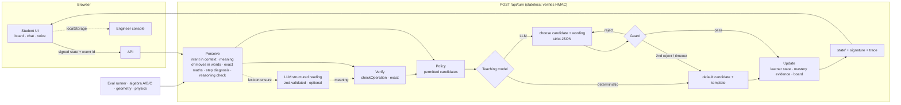

# TutorOS — a teaching-policy engine for 1:1 AI tutoring

A proof-of-work for a founding-engineer role at an AI-tutoring startup. One skill (Grade 7 two-step linear equations), done deeply enough to inspect.

**Thesis:** the model is not the product. An unguided LLM is a helpful chatbot, and helpful chatbots hand over answers — which [measurably hurts later independent performance](https://ideas.repec.org/a/nas/journl/v122y2025pe2422633122.html). TutorOS splits the job so each part can be tested:


## Project ownership and development approach

TutorOS is an independently developed AI-tutoring proof of concept exploring how to make tutoring decisions observable, testable, and grounded in student reasoning.

The project combines product design, interactive learning experiences, deterministic subject-specific verification, a teaching-policy engine, and an engineering console for inspecting tutor decisions.

**Development approach:** AI-assisted engineering using Claude Code, with an emphasis on iterative implementation, debugging, automated evaluation, and documenting limitations.

The repository includes:
- Three interactive lessons: algebra, physics, and geometry
- A shared tutoring experience with text and browser-based voice controls
- A deterministic verification and teaching-policy system
- An Engineer View for inspecting decisions and running evaluations
- Automated tests, architecture documentation, and a technical case study

This is a proof of concept, not a clinically or educationally validated learning system. Live-model behavior and real-device voice performance require separate verification.

**Why I built it:** To explore how AI tutoring can move beyond answering questions toward guiding students through their own reasoning, while giving engineers the tools to understand and improve teaching behavior.


| Job | Who does it | Why |
|---|---|---|
| Is the maths right? Why is it wrong? | **Deterministic perception**: exact-rational parser/solver, step-level misconception matching, reasoning checks | Correctness must never depend on a model. |
| Which moves are allowed now? | **Teaching policy** (rule table) → a set of *permitted* candidate decisions | Pedagogy you can diff, test and A/B. Fixes reveal rules and hint progression. |
| Which permitted move, and in what words? | **LLM** (if configured) — or the policy's default + templates | Adapts to the student's words and mood, inside the fence. |
| Is what the tutor says safe to say? | **Guard** on every utterance: answer/step leaks, false arithmetic, ungrounded equations, length | One repair retry, then deterministic fallback. |
| Has the student learned it? | **Mastery estimate** from independent first attempts only | Guided or assisted success is never counted as evidence. |

Three lessons and an Engineer View:
- **Home** (`/`): choose a lesson — algebra (two-step equations), physics (forces and balance) or geometry (angles in a triangle). Each card shows the goal, level and time, and **Continue learning** when a lesson is in progress in this browser. Every lesson keeps its own saved session, so going home never loses progress.
- **Lessons** (`/learn/algebra`, `/learn/physics`, `/learn/geometry`) share one tutoring shell: the conversation, voice and text input, sound controls, help options, the NOTICE → THINK → TRY hint ladder, progress rail, menu, transcript and error recovery. Each subject brings its own working panel and its **own deterministic verifier** — there is no general reasoning engine.
- **Algebra** (`/learn/algebra`): two panels. **Your working**: the problem and each line the student writes; accepted lines are joined by the operation they performed ("− 5 on both sides"), rejected ones are struck through with what was actually done to each side, and the line the tutor's latest message is about is marked with its terms highlighted. **Your tutor**: the whole conversation in full, then the input (type or speak) and two or three help options. Transcript, My progress, Restart and the voice settings are in the top bar's **Menu**.
- **Physics** and **geometry**: the question, a figure drawn to scale from the problem's numbers (force arrows on a box; a triangle with its angle arcs), the student's answers marked correct / partly right / not yet, and an explorer (drag the triangle's corner and watch the total stay at 180°; set two pushes and see the net force).
- **Engineer View** (`/console`), for any lesson session in this browser: **Overview** (lesson, objective, progress, answers checked, help given, model usage and fallbacks, recent interactions), **Decision timeline** (one card per turn: what the student said, what the tutor understood and who read it, how it was checked, why it replied, what it said — with the full stage-by-stage trace and evidence tabs under *Technical details*), **Evaluation lab** (live runs: baseline, deterministic tutor, real model — *not tested* without a key — plus the geometry and physics suites, with a per-scenario inspector) and **Architecture & safety** (the pipeline, verifiers per lesson, leak and correctness guards, fallbacks, live model configuration, and the rule and misconception reference).

> Status: **v4** (9 Oct 2026): a lesson home screen, two new lessons — physics (forces and balance) and geometry (angles in a triangle), each with its own exact verifier on a shared tutoring kernel — and a redesigned Engineer View ([docs/AUDIT.md](docs/AUDIT.md#v4-lessons-and-engineer-view)). **v3.4** (8 Oct 2026): the tutor understands moves described in words — "I'll do BODMAS multiplication", "take five away", "move the 5 to the other side", "no, I meant subtract" — reads them against the current equation and its own last question, verifies them exactly, remembers what was said, and repairs when a student repeats themselves ([docs/AUDIT.md](docs/AUDIT.md#conversational-understanding-v34)). **v3.3** (8 Oct 2026): audio under the student's control — start screen, Stop/Replay, a single speech controller that fixes the stutter ([docs/AUDIT.md](docs/AUDIT.md#tutor-speech-stutter-and-unexpected-audio-v33)). **v3.2**: visual refinement — two-panel workspace, full conversation, one type system ([docs/DESIGN.md](docs/DESIGN.md#v32-visual-refinement)). **v3.1**: voice input rebuilt as a state machine, natural student language, progressive NOTICE → THINK → TRY teaching ([docs/AUDIT.md](docs/AUDIT.md#voice-and-teaching-intelligence-upgrade-8-oct-2026)). What is and isn't verified: [docs/LIMITATIONS.md](docs/LIMITATIONS.md). v2 fixed correctness after a self-audit ([docs/AUDIT.md](docs/AUDIT.md)); v3 redesigns the interaction around a single exercise-book page with the tutor writing in the margin, separates *observed* operations from *inferred* misconceptions, and rebuilds the console as a decision debugger ([docs/DESIGN.md](docs/DESIGN.md)). Before/after: `docs/screenshots/compare-*.png`.

---

## Quick start (fine on a MacBook Air M1, 8 GB)

Requires Node.js 20.12+ (tested on 22) and npm.

```bash
npm install
cp .env.example .env.local     # optional — every variable is optional for local use
npm run dev                    # http://localhost:3000 (home) · /learn/algebra · /learn/physics · /learn/geometry · /console
```

Production mode: `npm run build && npm start` (port 3000; `npm start -- -p 3100` for another).

### Commands

| Command | What it does |
|---|---|
| `npm run dev` | Development server with hot reload |
| `npm run build` / `npm start` | Production build / serve it |
| `npm run typecheck` | TypeScript, no emit |
| `npm run lint` | ESLint |
| `npm test` | Unit + integration tests (vitest) |
| `npm run test:e2e` | Browser tests (Playwright). Builds and starts the app on port 3100 unless `E2E_BASE_URL` points at a running one. First time: `npx playwright install chromium` |
| `npm run eval` | Algebra policy comparison A/B/C on 50 scenarios, plus the geometry (G, 14) and physics (P, 11) suites; writes `eval-results.json` |
| `npx tsx scripts/ui-audit.ts` | Visual audit against a running server (`BASE=http://localhost:3000`): screenshots every screen at 320–1440 px and 200 % zoom, reports overflow, clipped text and overlapping controls |

### Environment variables

All optional for local use. Names and comments are in [`.env.example`](.env.example); put values in `.env.local` (git-ignored, read by Next.js and by `npm run eval`). Keys are only read on the server.

| Variable | Purpose |
|---|---|
| `ANTHROPIC_API_KEY` | Enables the LLM teacher via Anthropic (default model `claude-haiku-5-5`) |
| `OPENAI_API_KEY`, `OPENAI_BASE_URL` | Enables it via any OpenAI-compatible endpoint (set `LLM_MODEL` too) |
| `LLM_PROVIDER`, `LLM_MODEL` | Choose provider / model explicitly |
| `LLM_TIMEOUT_MS` | Per-call timeout (default 8000) |
| `LLM_MAX_CALLS_PER_SESSION` | Cost cap: model calls one lesson may make; after that the lesson continues deterministically (default 150) |
| `PRICE_INPUT_PER_MTOK`, `PRICE_OUTPUT_PER_MTOK` | USD per million tokens; without them cost is shown as unknown, never guessed |
| `SESSION_SECRET` | HMAC key (32+ chars) for signing session state. **Required in production**; without it a fixed dev key is used and `/api/health` reports `degraded` |
| `EVAL_TOKEN` | In production, required as `x-eval-token` to run the paid LLM eval from the console |

- **No key → Deterministic mode**, stated in the student **Menu** and in the console header (the student panel itself doesn't advertise the engine). Perception, policy, guard and mastery are all real; the policy's default move is always taken and wording comes from templates. No model calls are made or reported.
- **With `ANTHROPIC_API_KEY` (or `OPENAI_API_KEY` + `LLM_MODEL`)** → LLM mode: the model chooses among permitted moves and writes the wording. Set `PRICE_*` to see cost.
- Voice input uses the browser's Web Speech API (Chrome/Edge). Everything else works in any modern browser.

## Talking to the tutor

**Voice** (Chrome or Edge; typing works everywhere). Tap the mic → **Listening**: what's been heard appears on the line (finished words in ink, the phrase in progress lighter). **✓ Done** sends it; **Edit** puts the words in the text box, unsent, so a misheard word can be fixed first; **✕** (or Esc) discards it and never sends. Pauses don't send anything. If the browser stops listening on its own, the words are kept and you get **Keep talking** / **Send**. **Nothing makes a sound unless the student asks:** the start screen offers **Start the lesson** (the tutor reads its replies aloud) or **Read without sound**; nothing plays on load, reload or navigation; the mic opens only from a tap and never reopens by itself; there are no idle follow-ups. The latest tutor message has **Stop** and **Replay**. Opening the mic stops the tutor first. Recognition is done by the browser (in Chrome, on Google's speech service); TutorOS never stores audio, only the finished words you send.

**Everyday phrases understood in deterministic mode** (explicit rules in `PHRASE_RULES`, `src/engine/intent.ts`):

| Student says (and close variations) | Tutor does |
|---|---|
| "I'm stuck", "I don't know", "Help me", "I need more help", "Give me a hint", "Small hint", "What do I do next?" | Next stage of help: NOTICE → THINK → TRY → show the step |
| "I'm confused", "I don't get it", "I'm lost" | Same ladder, starting with one small choice |
| "Explain it another way", "Can you explain that again?", "Explain differently", "I still don't get it" | Same amount of help, a different explanation each time |
| "Why?", "How come?", "Why does that work?" | Explains the idea behind the tutor's last move — or asks which part, if that isn't clear |
| "Why did you subtract five?", "Can we divide first?", "What does = mean?" | Answers the idea, never the step result |
| "Can you show me a small example?" | Works a smaller equation with different numbers, then hands theirs back |
| "Can we go slower?" | Points at one part only; read-aloud slows down |
| "Don't tell me the answer", "Let me try it myself" | No worked solution for the rest of the lesson; hints stop at naming the move |
| "I think that's wrong", "Your answer is wrong" | Re-derives what was shown, with its arithmetic |
| "Say that again", "What?" | Repeats |
| "Okay", "Got it" | "Go ahead and write your next line" |
| Short and unclear ("hmm", "the left one") | One short clarifying question |
| Cut off mid-sentence ("I think we…") | Quotes what it heard and asks them to finish |
| "This is stupid, I hate this" | Acknowledges it and makes the task smaller (not "let's park that") |

**Moves described in words** (an operation lexicon in `src/engine/understand.ts`, read against the current equation and the tutor's last question, then checked exactly):

| Student says (on 3x + 5 = 20) | Read as | Exact verdict | Tutor does |
|---|---|---|---|
| "I will do BODMAS multiplication.", "I'll do multiplication first", "Why can't we multiply?" | multiply, no number, BODMAS framing | `evaluation_order` | Acknowledges the idea; BODMAS is for working out a value, solving undoes in reverse; points at the + 5; asks what undoes adding 5 |
| …then "I said will do multiplication." | the same proposal, repeated | `evaluation_order` + repeat | "Yes, I heard you say multiplication. You're thinking about the 3 times x part — that matters, and we'll get to it. But first we need to undo the + 5. What operation undoes adding 5?" A third time, it names the move directly (not the result) |
| "Take five away", "Subtract five from both sides", "minus 5 on both sides" | subtract 5 | `correct_next` | Confirms why, asks what the equation becomes — never writes it for them |
| "Move the five to the other side" | subtract 5, both sides | `correct_next` | "Moving the 5 across" really means subtracting 5 from both sides |
| "No, I meant subtract." | correction | `correct_next` | "Got it: subtract, not multiply." then as above |
| "Add 5 to both sides" | add 5 | `wrong_inverse` | Shows the computed result (3x + 10 = 25) and asks what undoes adding 5 |
| "Subtract 5 from the left side" | subtract 5, left only | `one_side` | Explains the balance breaks; asks about the right side |
| "I'll divide both sides by 3 first" | divide 3 | `divide_first` | Yes, valid — but 5 becomes 5/3; lets them choose |
| "The 5 first", or "multiplication" in reply to "which one first?" | points at a part | — | Answers in the context of its own question |
| "Subtract 5 from" … "both sides" | the second message finishes the first | `correct_next` | Reads them together |

This is still explicit matching — a lexicon, not open-ended language understanding. It covers the documented forms and their close variations. What it doesn't cover gets a clarifying question; with an LLM configured, it goes to the model for a **structured reading** that is then verified the same way. Equations are always read by the exact parser, never by the lexicon or a model.

Near the input, **two or three help options** ("I'm stuck", "Explain differently", "Small hint", "Why?") are picked for the moment. They send the same words a student could type or say.

## Physics and geometry: what the tutor checks

Both lessons run on `src/engine/subjects/kernel.ts` (shared: requests, ladder, reveal-after-effort, leak guard, progress, trace) with a subject module that owns reading and verifying:

| | Physics — forces and balance | Geometry — angles in a triangle |
|---|---|---|
| Questions | Net force from two opposite pushes; the extra force needed to balance; what balanced forces do to a moving trolley; what unbalanced forces do to a box at rest. One solved together, two checks, generated from the session seed. | Two given angles; right-angled; isosceles (find a base angle, or the top angle). One solved together, two checks. |
| Verifier | Net force computed exactly; size and direction checked separately ("4" → right size, which way?). Motion questions are matched against a **closed list** of outcomes (stays still, same speed, speeds up, slows down, starts moving + direction); anything else is not judged — the tutor says what it can check. | 180° rule computed exactly, with the isosceles base-angle rule. Stated calculations ("180 − 65 − 40 = 74") are re-checked. |
| Recognised mistakes | Added opposite forces, called unequal forces balanced, gave one force, wrong or missing direction, "a moving object needs a force to keep moving" (with friction named as the hidden force), balanced forces speed up / stop it, unbalanced forces leave it still. | Added the known angles, used 360°, subtracted only one angle, forgot the right angle, forgot to halve, assumed all angles equal, used 60°, arithmetic slip, impossible angle. |
| Not supported | Forces at angles, more than two forces per side, mass and acceleration, free-text explanations of why. | Exterior angles, angles on parallel lines, non-integer angles, proofs. |

Without a language model, the lessons understand numbers (digits and words: "seventy five degrees", "four newtons to the right"), units, directions, a closed list of words, and the shared request phrases; the start screen and menu say so. With a model configured, text the rules can't place gets a reading into the same closed labels (numbers must be ones the student said), and the subject verifier still decides. Wording in these lessons is always templated.

## What is LLM-powered, and what is deterministic

**LLM (only when configured):**
1. Choosing **one of the moves the policy permits** for this turn — e.g. a computed check instead of a question for a student who is frustrated — and writing the wording. Output: strict JSON `{candidate_id, utterance, rationale}`; `candidate_id` is an enum of the permitted ids.
2. Interpreting a **free-text explanation** ("I put the 3 and 5 together") into a misconception id. Strict JSON, enum-constrained; falls back to a keyword heuristic.
3. Interpreting **student text the word lists didn't place** ("yeet the 5 outta there", "my brain hurts") into a **structured meaning**: `{kind: operation | choose_part | help_request | unclear | off_topic, operation: add|subtract|multiply|divide|null, number, sides, framing, part, mentions_order_of_operations, is_question, is_correction, confidence}`. Strict zod schema (unknown fields, e.g. a model-invented `correct: true`, are rejected); confidence ≥ 0.6; **a number is accepted only if the student actually said it**; equations are never sent. The model has no field for whether a move is right: the reading goes through the same exact `checkOperation` as the lexicon's, then the policy decides. Timeouts and failures fall back to the deterministic path (a clarifying question). The console labels it "LLM interpretation" and shows the call.
4. In **physics and geometry**, reading text the rules can't place into the lesson's closed labels (answer value / direction / outcome, concept, topic, help). Strict schema; numbers must appear in the student's words; the subject verifier decides. Tested with a fake provider only.

**Deterministic, always:** whether a described move is right (`checkOperation`, exact); conversation memory (what the tutor is waiting for, the last proposal, repeats, corrections); parsing typed and spoken maths; equivalence and solving (exact rationals); step-level and value-level diagnosis; checking stated reasoning; which moves are permitted; whether the answer or next step may be revealed; hint-ladder progression; the substitution/step checks shown to the student; the whiteboard; mastery evidence; phase transitions; the guard.

**The model never sees a decision it can't make and never produces a validation result.** It receives the checker's verdict as input. It can't invent an action (enum), can't skip a hint rung (not among the candidates), can't reveal the answer (guard), can't state false or ungrounded maths (guard). Rejected outputs are retried once with the reasons; then the policy default is used. All of it is in the trace.

Changing provider = one class implementing `LlmProvider.generateJson()` (see `src/engine/llm/`). The engine never imports a vendor SDK.

## Evaluation — actual results (8 Oct 2026, this repository)

```bash
npm run eval          # runs A, B and C (C only if a provider is configured); writes eval-results.json
```

50 scenarios script the **student** (19 new in v3.4 for conversation: the reported BODMAS exchange, moves in words, repeats, corrections, speech-recognition spellings, cut-off and continued sentences, frustration, answer-reveal attempts, voice/text switching, multi-turn continuity); the **tutor** is the real `step()` the UI calls. Assertions check properties (category in brackets), and accept any move the policy permits, so the same suite runs against templates and LLMs.

| Policy | Scenarios | Assertions | Scenarios with answer leak | False maths stated | Leak | Maths | Diagnosis | Appropriate response | Repeated-error recovery | Mastery measurement | Robustness | Latency p50/p95 | Model calls · cost |
|---|---|---|---|---|---|---|---|---|---|---|---|---|---|
| **A** baseline answer-giver (negative control) | 7/50 | 99/212 | 25 | 0 | 2/38 | 36/42 | 12/12 | 22/76 | 6/19 | 12/12 | 9/13 | ≤ 3 ms (varies run to run) | 0 · n/a |
| **B** tutor-v1, deterministic | **50/50** | **212/212** | **0** | **0** | 38/38 | 42/42 | 12/12 | 76/76 | 19/19 | 12/12 | 13/13 | ≤ 1 ms | 0 · n/a |
| **C** tutor-v1 + LLM | **not run** — no provider credentials in this environment. Not simulated. | | | | | | | | | | | | |

Geometry and physics (deterministic, same harness): **G 14/14 scenarios, 40/40 checks; P 11/11 scenarios, 30/30 checks**; 0 answer leaks, 0 false maths, 0 model calls. Their scenarios were written alongside the verifiers, so they show the documented behaviour works, not that unseen phrasings will.

How to read it:
- **A vs B** isolates pedagogy: A uses the same perception and measurement but always explains the full solution. It leaks the answer in 25 scenarios and fails most appropriateness checks.
- **Diagnosis and mastery score 100% for A too** — correct, not a bug: they're computed by the deterministic perception/measurement layer for every policy. They show the instrument works; they don't show B teaches better.
- **What B's 50/50 does *not* prove:** that the lexicon understands language beyond the forms it was written for (the scenarios were written alongside it), or that students learn. These are behavioural tests against a scripted student. B's wording is templated and can feel repetitive.
- **C** needs `ANTHROPIC_API_KEY` (or an OpenAI-compatible key) in `.env.local`. Then the same command and the console's *Run comparison* fill the row with real tokens, latency and (if priced) cost. Exact steps: [docs/LIMITATIONS.md](docs/LIMITATIONS.md#policy-c-llm-teacher-has-not-been-run-against-a-real-model).

## Tests — actual results (final release audit, 8 Oct 2026)

| Check | Command | Result |
|---|---|---|
| Typecheck | `npm run typecheck` | clean |
| Lint | `npm run lint` (ESLint 9, typescript-eslint, react-hooks, next) | 0 errors, 0 warnings |
| Unit + integration | `npm test` | **278 / 278 passed** (15 files) |
| Scenario evals | `npm run eval` | B 50/50 (212/212 assertions) · A 7/50 · C not run · G 14/14 · P 11/11 |
| Production build | `npm run build` | passes |
| Browser e2e (Playwright, Chromium) | `npm run test:e2e` | **41 / 41 passed** (6 files, against the production build; two consecutive runs). `e2e/navigation.spec.ts` covers the full journey (home → algebra → wrong answer → hint → home → resume → complete → Engineer View trace → evaluation → home), browser back/forward, the logo and "All lessons" on all three lessons, reload, per-lesson progress and Start again |
| Visual audit | `scripts/ui-audit.ts` | home, three lessons and every Engineer View tab at 320–1440 px and 200 % zoom: no layout defects found |
| Fresh install | `npm ci && npm run build && npm start` in a clean copy | starts; `/api/health` responds |

What the 275 tests cover — v4 adds `tests/subjects.test.ts` (36 tests: spoken and written number reading, arithmetic re-checks, both problem generators over 400 seeds, every verifier verdict and recognised mistake, a leak sweep over more than 5,000 hint / explanation / example / feedback replies, every geometry and physics scenario, idempotency, voice = typing, the structured model reading with a fake provider — verified, invented numbers rejected, closed labels enforced, timeout fallback — and the API refusing a state from another lesson). `e2e/home-subjects.spec.ts` covers the home screen and Continue, a geometry lesson to question 3 including the explorer, a physics lesson with a spoken answer and the bounded outcome check, the Engineer View for a geometry session, and phone width. v3.4 adds `tests/understand.test.ts` (41 tests: interpretation of each documented phrasing, exact verdicts on four equation shapes, the reported BODMAS conversation as a regression, repeats, corrections, frustration, "Wait, why?", one-question replies, idempotent events, identical voice/typed handling) and structured-LLM-interpretation tests in `tests/language.test.ts` (fake provider: operation readings verified exactly, a model can't make a wrong move right, invented numbers and invented fields rejected, timeout fallback, the per-session call budget). v3.1 adds `tests/voice.test.ts` (voice state machine with a fake recognizer: start, cancel, Done, pauses, interim vs final, duplicate events, permission denied, no microphone, unsupported, browser-ended sessions and capped resume, rapid start/cancel, dispose), `tests/speaker.test.ts` (no overlapping tutor speech, cancelled speech never reports "finished", maths read as words, phrase splitting, speech errors can't crash the page) and `tests/language.test.ts` (every documented phrase, NOTICE → THINK → TRY, rephrasing, bare "why?", ambiguity, "don't tell me the answer", ~1,000 explanation texts checked for leaks and false maths, LLM interpretation boundary with a fake provider). Earlier: algebra (exact, spoken, malformed); misconception diagnosis by step and by value; one regression test per audit finding; guard (leaks, false arithmetic, ungrounded equations, quoting); BKT and evidence states; engine purity, idempotency, session cap; the LLM layer with fake providers (non-default choice, invented candidate → schema reject, answer leak → guard reject → retry → fallback, false arithmetic rejected, transport failure → immediate fallback, reveal can't be unlocked, classification fallback); provider transport (retry, timeout, no retry on 4xx); **real HTTP round-trips through the Anthropic SDK and the OpenAI-compatible client against local fake servers** (no network, no keys); API routes (signed resume, tamper → 409, duplicate events, input validation, rate limiting, C reported as not run).

v3 adds `tests/presentation.test.ts`: observed operations, confidence caps, no misconception labels in any delivered utterance, and note anchoring/term focus.

The e2e suite drives the real UI. `e2e/voice.spec.ts` replaces the browser's speech APIs with a controlled mock (no microphone exists in automation) and tests listening, ✕ and ✓, permission denied, no microphone, unsupported browsers, browser-ended sessions, duplicate events, rapid start/cancel, spoken help requests, the tutor never being recorded, keyboard-only voice and the phone layout. `e2e/audio.spec.ts` covers the start screen and audio control: nothing on load, the intro spoken exactly once in one voice, no idle follow-ups (a minute of fake time), Read without sound surviving reload, no replay after reload or navigation, Stop and Replay, repeated clicks never stacking audio, and the mic stopping the tutor first and never reopening by itself. `e2e/controls.spec.ts` walks the complete student journey and presses every visible control (help options, full conversation history, past-problem expand, menu, scratch pad, drawers incl. Escape, console tabs, eval inspector, Restart, Delete my data), plus Cancel during a pending turn, reduced motion and keyboard-only use. `e2e/lesson.spec.ts` covers a full lesson to mastery (checking that the hint highlights exactly `+ 5` and `20`, that observed operations appear between lines, and the console's observed/hypothesis stages); unexpected inputs and quick replies; reload-and-resume plus a tampered session being refused; the eval matrix and failure inspector; and a mobile layout with no horizontal scroll.

## Architecture



```
src/engine/                    framework-free TypeScript
  algebra.ts  fraction.ts      exact parser/solver; typed + spoken maths
  intent.ts                    clause-level intent: answers, steps, questions, disputes, malformed maths…
  understand.ts                moves described in words → structured meaning; checkOperation (exact verdict)
  subjects/                    kernel.ts (shared tutoring kernel), geometry.ts, physics.ts (readers + verifiers),
                               text.ts (number words, arithmetic re-checks), eval.ts (G/P scenarios)
  misconceptions.ts            executable misconception taxonomy; diagnoseStep / diagnoseValue
  reasoning.ts                 checks reasoning stated alongside an answer
  policy.ts                    the rule table → permitted candidates; concept answers; computed checks
  guard.ts                     output guard
  mastery.ts                   BKT + evidence rules (documented assumptions)
  engine.ts                    perceive → permit → choose → update; idempotency
  llm/                         provider seam (anthropic.ts, openai.ts), teacher.ts, factory.ts
  eval/                        scenarios.ts (50), runner.ts (metrics)
src/app/                       Next.js: home, /learn/{algebra,physics,geometry}, console, /api/turn, /api/eval, /api/health, error boundaries
src/components/                Home, lesson/LessonShell (shared shell), StudentApp (algebra), SubjectLesson, lesson/figures, ConsoleApp + console/
src/lib/server/                session signing, rate limiting, redacted logging
tests/  e2e/                   vitest, Playwright
docs/                          AUDIT, RESEARCH, CASE_STUDY, DEMO_SCRIPT, INTEGRATION, OUTREACH
```

## Measurement — what "mastered" means here

Documented in `src/engine/mastery.ts` and the console's *Policy & measurement* tab:
- BKT with conventional priors (not fitted to data).
- Evidence = first attempts without help only: the guided problem's first attempt (pre-check) and each fresh problem's first attempt. Asking for help or saying "I'm confused" before attempting a fresh problem counts as an unsuccessful attempt.
- Finishing after hints, a reveal, or with invalid stated reasoning = **assisted**: never evidence.
- **Mastered** = P(known) ≥ 0.9 **and** two consecutive independent solves on fresh problems with different surface forms. Fewer than two independent fresh attempts = **insufficient evidence**.
- Misconceptions seen on more than one problem are tracked as **recurring**, and the policy addresses them directly (R5b) instead of re-probing.

This is an instrument for estimating understanding within a session — not a validated assessment, and no claim about learning gains.

## Reliability and data handling

- **Signed session state:** the server is stateless; the browser holds state + an HMAC the server issued. Edits → 409 and a "start a new lesson" path. Survives reloads.
- **Idempotency:** every event has an id. A duplicate against the post-state is a no-op; a retry against the pre-state recomputes the same turn once; the client discards stale responses.
- **Model calls:** per-call timeout (AbortController), one transient retry (timeouts, 429, 5xx), schema validation, guard, one repair retry, deterministic fallback.
- **Input validation** (zod), 512 KB body limit, 500-char messages, 300-turn session cap, per-IP rate limits (in-memory, per instance).
- **Logs:** structured JSON with request id, hashed trace/session ids, rule, timings, model-call counts. **No student text or tutor utterances.**
- **Student data:** no name, no account, no audio stored. Transcripts live in the student's browser; the profile drawer shows everything stored and deletes it.
- **Health:** `/api/health` reports teacher mode, pricing config, and `degraded` when `SESSION_SECRET` isn't set.
- Route-level error boundary with recovery.

## Known limitations

Full list, with what has and hasn't been verified: [docs/LIMITATIONS.md](docs/LIMITATIONS.md).

- **C (LLM policy) has not been run against a live model here.** Control logic is tested with fakes and local HTTP fakes; real-model teaching quality, latency and cost are unmeasured until someone runs `npm run eval` with a key.
- One skill, integer answers, a fixed guided problem (3x + 5 = 20); transfer problems are seeded.
- BKT parameters are priors, not fitted. Mastery is within-session only; no retention check.
- Intent parsing for non-maths text is rule-based; it handles the probed cases, not open-ended language. With an LLM, free-text explanations are classified by the model; other intents stay rule-based by design.
- Rate limiting (in memory, per instance) and the fallback development signing key are not production-grade.
- Web Speech API: Chrome-family only for input, and Chrome sends audio to Google's speech service.
- Deterministic wording is templated and can feel repetitive.

## Before this goes in front of real children (not done)

1. **Run C and review it with teachers:** real-model evals, plus expert review of a sample of real transcripts; add LLM-judge rubrics only after they agree with human raters.
2. **A small supervised pilot** with consent from parents/schools, and a delayed independent retest per skill — the only honest learning metric.
3. **Child-data compliance:** a lawyer-reviewed basis under India's DPDP Act (verifiable parental consent for under-18s, no tracking/behavioural monitoring of children) and COPPA/GDPR-K if relevant; data-processing agreements with the speech and model providers; retention limits.
4. **Safety:** content moderation on free text (the redirect handles off-topic, not harmful disclosures), and an escalation path to an adult when a child says something worrying.
5. **Server-side persistence** (Postgres via `SessionStore`) with auth, audit logs and deletion on request; distributed rate limiting; secrets in a vault; monitoring and alerting on fallback and guard-rejection rates.
6. **Accessibility testing** with real users (screen readers, low vision, dyscalculia) and voice testing with Indian-English accents.

## Deploy (Vercel)

```bash
vercel
vercel env add SESSION_SECRET          # required: 32+ random characters
vercel env add ANTHROPIC_API_KEY       # optional: enables the LLM teaching layer
vercel env add EVAL_TOKEN              # optional: allows LLM evals from the console in production
vercel --prod
```

No database is required. `/api/eval` declares `maxDuration = 300`; on plans with shorter limits, run LLM evals from the CLI.

## Docs
- [docs/ARCHITECTURE.md](docs/ARCHITECTURE.md) — teaching policy, deterministic validation, LLM boundaries, sessions, evaluation design
- [docs/LIMITATIONS.md](docs/LIMITATIONS.md) — what has and hasn't been verified; how to run Policy C
- [docs/DESIGN.md](docs/DESIGN.md) — v3 interaction design and what changed
- [docs/AUDIT.md](docs/AUDIT.md) — v1 audit, v2 fix log, v3 observed-vs-inferred audit
- [docs/RESEARCH.md](docs/RESEARCH.md) — research, JD decode, option scoring
- [docs/CASE_STUDY.md](docs/CASE_STUDY.md) — technical case study
- [docs/DEMO_SCRIPT.md](docs/DEMO_SCRIPT.md) — the 90-second walkthrough
- [docs/INTEGRATION.md](docs/INTEGRATION.md) — HTTP contract and embedding
- [docs/OUTREACH.md](docs/OUTREACH.md) — messages, talking points, questions
